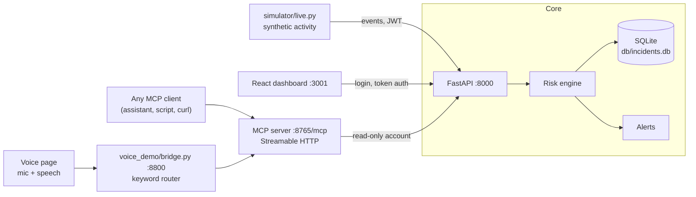

# Sentinel

**Real-time security monitoring and fraud detection, with explainable risk scores and a voice-queryable MCP interface.**

Sentinel watches user activity and transactions, scores each event for risk from 0 to 100, and raises an incident when something looks dangerous, always with the exact reasons behind the score. You can work with those incidents in a live web dashboard, through a REST API, or by asking an AI assistant, by voice if you like, through a built-in [Model Context Protocol](https://modelcontextprotocol.io) (MCP) server.

<!-- Add screenshots here: docs/dashboard.png and docs/voice-demo.png -->

---

## Contents

- [Why Sentinel](#why-sentinel)
- [Features](#features)
- [Architecture](#architecture)
- [How risk is scored](#how-risk-is-scored)
- [MCP server](#mcp-server)
- [Voice demo](#voice-demo)
- [Getting started](#getting-started)
- [Verifying your setup](#verifying-your-setup)
- [Project layout](#project-layout)
- [Security model](#security-model)
- [Status and known gaps](#status-and-known-gaps)
- [Roadmap](#roadmap)
- [License](#license)

---

## Why Sentinel

Most monitoring tools give you a number and leave you to work out what it means. Sentinel is built around the opposite idea: **every flag has to be explainable.** An incident is never just "score 100". It carries the list of signals that produced it, such as seven failed logins against a threshold of five, access at 04:00 UTC, and a never-seen IP address, so an analyst can judge it in seconds.

The second idea is that a security question should be as easy to ask as it is to answer. Instead of opening a dashboard and filtering tables, you can ask "any critical incidents?" and get a spoken, sourced answer from live data.

## Features

- **Explainable risk engine.** Rule-based signals are blended into a 0 to 100 score and a severity level (`LOW`, `MEDIUM`, `HIGH`, `CRITICAL`). Every incident stores its full list of reasons.
- **Activity and transaction scoring.** Login and command activity, and financial transactions, go through the same engine and are blended.
- **Live dashboard.** A React dashboard with login, an Overview, and an Incidents view with search, severity and type filters, and automatic refresh every few seconds.
- **Authenticated API.** FastAPI backend with JWT token authentication and `admin` / `viewer` roles, plus rate limiting.
- **MCP server.** Five read-only tools over the Streamable HTTP transport (spec `2025-11-25`), so any MCP-capable assistant can query Sentinel.
- **Voice demo.** A browser page that listens, calls the MCP tools and speaks the answer, simulating an Alexa+ style assistant.
- **Realistic simulator.** A live generator of normal and malicious activity, so you can see the system working without real traffic.
- **One-command tooling.** `scripts/dev.sh` runs the stack and `scripts/check.sh` verifies it, including conformance with the MCP transport rules.

## Architecture



The MCP server is a separate process that talks to the API through its own read-only account, so assistants only ever see what that account is allowed to see. The voice demo is just one more MCP client: it reaches Sentinel exclusively through the MCP endpoint.

## How risk is scored

Each event is checked against a set of signals. The signals that fire are combined into a score between 0 and 100, and the score maps to a severity level. A score of **75 or more is `CRITICAL`**.

| Signal | Example reason stored with the incident |
|---|---|
| Excessive failed logins | `Excessive failed logins: 7 attempts (threshold: 5)` |
| Off-hours access | `Off-hours access: activity at 04:00 UTC (window: 00:00-05:00 UTC)` |
| Unknown IP address | `Unknown IP address: 203.0.113.99` |
| Suspicious command | `Suspicious command detected: 'bash -i'` |

An incident looks like this when explained through MCP:

```json
{
  "id": 765,
  "level": "CRITICAL",
  "score": 100.0,
  "user": "alice",
  "ip": "203.0.113.99",
  "state": "open",
  "time": "2026-10-23T12:31:49+00:00",
  "top_reason": "Excessive failed logins: 7 attempts (threshold: 5)",
  "reasons": [
    "Excessive failed logins: 7 attempts (threshold: 5)",
    "Off-hours access: activity at 04:00 UTC (window: 00:00-05:00 UTC)",
    "Unknown IP address: 203.0.113.99",
    "Suspicious command detected: 'bash -i'"
  ]
}
```

## MCP server

MCP is an open standard that lets an AI assistant call tools on a server. Sentinel's MCP server turns the incident database into five tools an assistant can use.

- **Endpoint:** `http://127.0.0.1:8765/mcp`
- **Transport:** Streamable HTTP, protocol version `2025-11-25`, with session management (`MCP-Session-Id`) and the `MCP-Protocol-Version` header
- **Access:** read-only

| Tool | Arguments | Returns |
|---|---|---|
| `ping` | none | Confirms the server is up |
| `get_open_incidents` | `min_score`, `limit` | Open incidents, newest first. Use `min_score=75` for critical only |
| `explain_incident` | `incident_id` | Score, severity and every reason for one incident |
| `summarize_recent` | `hours` | Counts by severity and the most serious incident |
| `top_risky_users` | `hours`, `limit` | Users ranked by incident count and highest score |

Call a tool from the shell with the included helper, which performs the full handshake (initialize, session id, initialized notification, call):

```bash
scripts/mcp_call.sh get_open_incidents '{"min_score":75,"limit":3}'
scripts/mcp_call.sh summarize_recent '{"hours":6}'
scripts/mcp_call.sh explain_incident '{"incident_id":765}'
```

## Voice demo

`voice_demo/` is a small web app that shows what an assistant experience on top of Sentinel looks like. Press the mic and ask:

- "Any critical incidents?"
- "Which users are risky?"
- "Summarize the last 6 hours."
- "Explain the latest incident."

The page sends your words to `bridge.py`, which chooses a tool, calls the MCP server, and returns the data plus a sentence for the browser to read aloud. Each answer card shows the exact tool call it made, so you can see what happened.

**How tools are chosen:** with simple keyword rules, not a language model. That keeps the demo free and dependable, but it only understands the phrases it was written for. Swapping in an LLM for this step is on the roadmap, and nothing on the MCP side would change.

**Browser notes:** speech recognition uses the browser's Web Speech API (Chrome or Edge, internet required). Typed questions and the example buttons work everywhere. On Linux, install `speech-dispatcher` and `espeak-ng` if you hear no spoken answers.

## Getting started

**Prerequisites:** Linux or macOS, Python 3.12, Node.js 18 or newer.

```bash
git clone <this repo>
cd Security-monitoring-and-Fraud-Detection-System

python3 -m venv venv
source venv/bin/activate
pip install -r requirements.txt

cd frontend && npm install && cd ..
```

### Configure

Settings live in a local `.env` file, which is git-ignored. The MCP server signs in to the API as a read-only `mcp_viewer` account; give it the password through the environment rather than writing it to disk:

```bash
read -s -p "mcp_viewer password: " SENTINEL_MCP_PASSWORD
export SENTINEL_MCP_PASSWORD
echo
```

### Run

```bash
scripts/dev.sh start     # API :8000, MCP server :8765, live simulator
scripts/dev.sh status    # show what is listening and running
scripts/dev.sh stop      # stop everything
```

In separate terminals, start the dashboard and, if you want it, the voice demo:

```bash
cd frontend && npm start          # dashboard, http://localhost:3001
python3 voice_demo/bridge.py      # voice demo, http://127.0.0.1:8800
```

The API also serves FastAPI's interactive documentation at `http://127.0.0.1:8000/docs`.

## Verifying your setup

```bash
scripts/check.sh
```

This prints PASS or FAIL for each item: API health, an MCP session, all five tools, the voice bridge (if running), and repository hygiene. It also tests the MCP transport rules that matter most for a server you run yourself:

| Rule from the Streamable HTTP spec | Expected result |
|---|---|
| Request with an invalid `Origin` header (DNS-rebinding protection) | `403` |
| Unsupported `MCP-Protocol-Version` | `400` |
| Request without `MCP-Session-Id` | `400` |
| Unknown `MCP-Session-Id` | `404` |
| Client notification accepted | `202` |

Unit tests:

```bash
venv/bin/python -m pytest tests -q
```

## Project layout

```
app/            FastAPI application: authentication, activity routes, health
engine/         Risk engine: signals, scoring, incident creation
alerts/         Alerting for high-risk incidents
sentinel_mcp/   MCP server exposing the five tools over Streamable HTTP
simulator/      live.py: generates normal and malicious activity
frontend/       React dashboard: login, Overview, Incidents
voice_demo/     Voice assistant demo: bridge.py and index.html
scripts/        dev.sh (start/stop/status), mcp_call.sh, check.sh
tests/          pytest suite
db/             SQLite database (git-ignored)
```

## Security model

- **Authentication.** The dashboard and API use JWT token authentication, with `admin` and `viewer` roles. Passwords are hashed.
- **Least privilege for assistants.** The MCP server uses a dedicated read-only account. A connected assistant can read incidents; it cannot change them.
- **Local by default.** The API, the MCP endpoint and the voice bridge all bind to `127.0.0.1`, and the MCP server validates `Origin` headers to block DNS-rebinding attacks.
- **Secrets stay out of git.** `.env`, databases and logs are ignored, and `scripts/check.sh` verifies none are tracked.
- **Not yet covered.** The MCP endpoint itself has no client authentication, which is acceptable for localhost but should be added before exposing it on a network (see the roadmap).

## Status and known gaps

Sentinel is a working project under active development. Being upfront about where it stands:

- **Dashboard coverage.** The React dashboard shows incidents and an overview, but not every capability the backend now has. Closing that gap is the next UI task.
- **Test suite.** 80 tests pass and 5 in `tests/test_engine.py` currently fail; they check the blended scoring and appear to lag behind recent engine changes.
- **Dashboard limits.** The Overview reads the latest 200 incidents and the Incidents page the latest 500, so totals on screen level off at those numbers while the simulator runs.
- **Incident counts in MCP.** Tool totals are computed from a capped query, so very large databases will under-report. Server-side `COUNT` queries will replace this.
- **Voice routing.** Keyword-based, as described above.

## Roadmap

- Authentication on the MCP endpoint, following the MCP authorization specification
- LLM-based tool selection in the voice demo
- Bring the dashboard up to parity with the backend
- Fix and extend the test suite, and run it in CI
- Server-side counts so totals are not limited by list size
- Per-IP rate limiting and alert routing by severity
- Real data sources beyond the simulator

## License

Released under the terms in [LICENSE](LICENSE).
