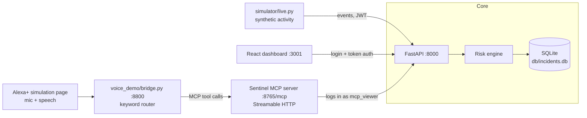

# Sentinel: Security Monitoring & Fraud Detection

Sentinel scores security activity and financial transactions in real time, turns the risky ones into incidents, and makes those incidents available three ways: a live web dashboard, a REST API, and a **Model Context Protocol (MCP) server** that an AI assistant, including a simulated Alexa+, can query by voice.

> Built for the **Amazon Developer Hackathon, Alexa+ track**: a self-hosted MCP server (spec `2025-11-25`, Streamable HTTP) plus a web-app simulation of an Alexa+ voice experience.

---

## Demo

- Video: _add your YouTube/Vimeo link here_
- Ask out loud: *"Any critical incidents?"*, *"Which users are risky?"*, *"Summarize the last 6 hours"*, *"Explain the latest one"*.

## How it fits together



The MCP server is the product's assistant-facing interface. The voice page and its bridge play the role of an Alexa+ device: a separate client that reaches Sentinel only through MCP, the same way any compliant host would.

## Risk engine

Every activity event is evaluated against rule-based signals and blended into a **0 to 100 score**, which maps to `LOW`, `MEDIUM`, `HIGH` or `CRITICAL` (75 and above is critical). Each incident stores its score and the full list of human-readable reasons, so a flag is always explainable.

| Signal | Example reason stored with the incident |
|---|---|
| Excessive failed logins | `Excessive failed logins: 7 attempts (threshold: 5)` |
| Off-hours access | `Off-hours access: activity at 04:00 UTC (window: 00:00-05:00 UTC)` |
| Unknown IP address | `Unknown IP address: 203.0.113.99` |
| Suspicious command | `Suspicious command detected: 'bash -i'` |

Transactions are scored by the same engine and blended with activity risk.

## MCP server

- **Transport:** Streamable HTTP, single endpoint `http://127.0.0.1:8765/mcp`
- **Protocol version:** `2025-11-25`, with session IDs (`MCP-Session-Id`) and the `MCP-Protocol-Version` header
- **Binding:** `127.0.0.1` only

| Tool | Arguments | What it returns |
|---|---|---|
| `ping` | none | Confirms the server is up |
| `get_open_incidents` | `min_score`, `limit` | Open incidents, newest first (`min_score=75` for critical) |
| `explain_incident` | `incident_id` | Score, severity and every reason for one incident |
| `summarize_recent` | `hours` | Counts by severity plus the most serious incident |
| `top_risky_users` | `hours`, `limit` | Users ranked by incident count and max score |

Try it from the shell:

```bash
scripts/mcp_call.sh get_open_incidents '{"min_score":75,"limit":3}'
scripts/mcp_call.sh explain_incident '{"incident_id":123}'
```

## Alexa+ simulation (`voice_demo/`)

A small web app that stands in for an Alexa+ device. Press the mic and speak; the page sends the transcript to `bridge.py`, which picks an MCP tool, calls the server over Streamable HTTP, and returns the data plus a sentence that the browser reads aloud. Each answer shows the tool call it made.

**Honest limitation:** with no paid LLM in the loop, tool selection uses simple keyword rules in `bridge.py`. Real Alexa+ would use its own model for that step. The MCP server and its tools are real and unchanged either way.

Speech recognition uses the browser's Web Speech API (Chrome or Edge, internet required). Typed input and example buttons work everywhere.

## Quick start

**Prerequisites:** Linux or macOS, Python 3.12, Node.js 18+.

```bash
git clone <this repo> && cd Security-monitoring-and-Fraud-Detection-System
python3 -m venv venv && source venv/bin/activate
pip install -r requirements.txt
cd frontend && npm install && cd ..
```

Create a local `.env` for your settings (it is git-ignored), then start the backend:

```bash
read -s -p "mcp_viewer password: " SENTINEL_MCP_PASSWORD; export SENTINEL_MCP_PASSWORD; echo
scripts/dev.sh start      # API :8000, MCP server :8765, live simulator
scripts/dev.sh status
```

Start the dashboard and the voice demo in two more terminals:

```bash
cd frontend && npm start                 # dashboard on http://localhost:3001
python3 voice_demo/bridge.py             # voice demo on http://127.0.0.1:8800
```

Stop everything with `scripts/dev.sh stop`.

## Verify it works

```bash
scripts/check.sh
```

One command checks the API, an MCP session, the Streamable HTTP rules below, all five tools, the voice bridge, and repo hygiene.

| Spec rule (2025-11-25) | Expected |
|---|---|
| Invalid `Origin` header rejected (DNS-rebinding protection) | 403 |
| Unsupported `MCP-Protocol-Version` | 400 |
| Request without `MCP-Session-Id` | 400 |
| Unknown `MCP-Session-Id` | 404 |
| Notification accepted | 202 |

Unit tests: `venv/bin/python -m pytest tests -q`.

## Project layout

```
app/            FastAPI app: auth (/auth/login), activity routes, health
engine/         Risk engine: signals, scoring, incident creation
alerts/         Alerting for high-risk incidents
sentinel_mcp/   MCP server (Streamable HTTP) exposing the five tools
simulator/      live.py: generates realistic and malicious activity
frontend/       React dashboard (Overview, Incidents, login)
voice_demo/     Alexa+ simulation: bridge.py + index.html
scripts/        dev.sh (start/stop/status), mcp_call.sh, check.sh
tests/          pytest suite
```

## Security notes

- Dashboard and API require login with token (JWT) authentication; roles are `admin` and `viewer`.
- The MCP server authenticates to the API as a dedicated read-only `mcp_viewer` account, with its password supplied through `SENTINEL_MCP_PASSWORD`, never committed.
- The MCP endpoint and the voice bridge bind to `127.0.0.1`. The MCP endpoint itself has **no client authentication yet**, which the spec recommends adding for anything beyond localhost.
- `.env`, databases and logs are git-ignored; `scripts/check.sh` verifies none are tracked.
- Known limitations: the dashboard overview shows the latest 200 incidents and the incidents page the latest 500; the voice bridge routes by keyword, not by a model.

## Hackathon submission

- **Track:** Alexa+ (self-hosted MCP server, Streamable HTTP, spec 2025-11-25, plus simulated Alexa+ web app)
- **Existed before the hackathon:** the risk engine, API and dashboard. _Edit this line if wrong._
- **Built during the hackathon:** the MCP server and its five tools, the Alexa+ voice simulation, dashboard login and token auth, live refresh, `dev.sh` and `check.sh`, and the spec-conformance checks.

## Roadmap

- Authentication on the MCP endpoint (OAuth, per the MCP authorization spec)
- LLM-based tool selection in the voice page, replacing keyword rules
- Server-side counts so totals are not capped by list limits
- Per-IP rate limiting and alert routing by severity

## License

See [LICENSE](LICENSE).
